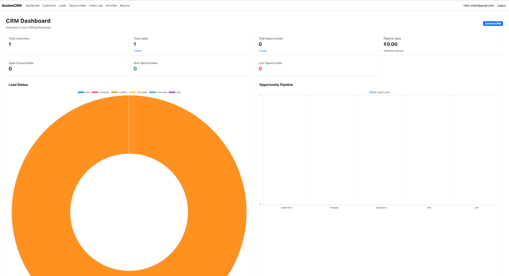
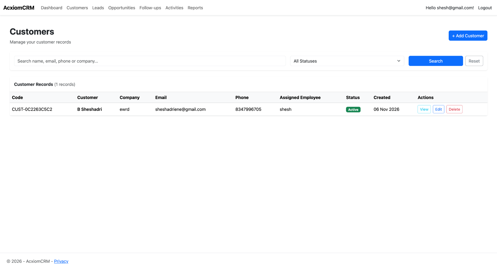
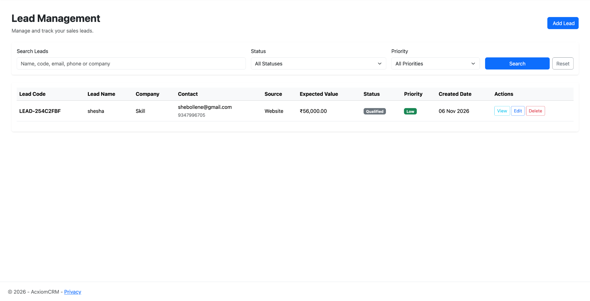
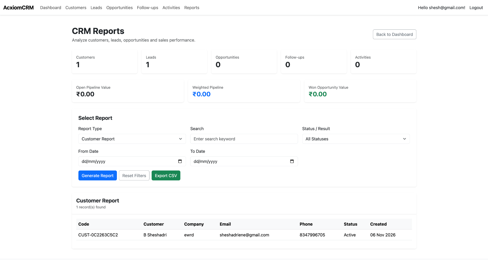

# AcxiomCRM

A Customer Relationship Management (CRM) web application built with ASP.NET Core MVC. It supports customer, lead, opportunity, follow-up and activity workflows, with role-based access for Admin, Manager and Sales Executive users.

## Features

- Authentication and role-based authorization
- Admin, Manager and Sales Executive roles
- Customer management and employee assignment
- Lead creation, tracking, filtering and conversion
- Opportunity management and pipeline tracking
- Follow-up and activity management
- Audit logs and CRM reports
- Dashboard with CRM KPIs and charts
- REST API endpoints

## Screenshots

### Dashboard


### Customer Management


### Lead Management


### Reports


## Technology Stack

- C#
- ASP.NET Core MVC (.NET 10)
- Entity Framework Core
- ASP.NET Core Identity
- SQLite
- Bootstrap
- JavaScript and Chart.js

## Run Locally

1. Clone the repository:

   ```bash
   git clone https://github.com/sheshadri7-b/AcxiomCRM.git
   cd AcxiomCRM
   ```

2. Restore dependencies:

   ```bash
   dotnet restore
   ```

3. Apply database migrations:

   ```bash
   dotnet ef database update
   ```

4. Run the application:

   ```bash
   dotnet run
   ```

5. Open the local URL printed in the terminal (typically `http://localhost:5000` or `https://localhost:5001`).

## Notes

- The application uses SQLite. The database file is created locally and should not be committed.
- Configure any environment-specific settings locally; do not commit credentials or secrets.
- User accounts and roles depend on the application's database initialization and registration/admin setup.

## Project Status

Developed as an academic CRM application demonstrating ASP.NET Core MVC, relational data access, authentication, role-based authorization and common CRM workflows.
